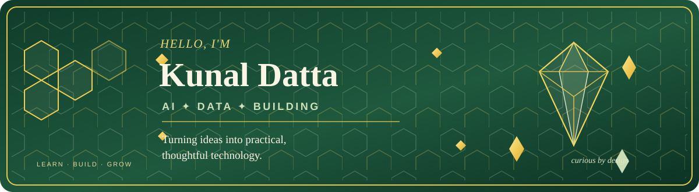
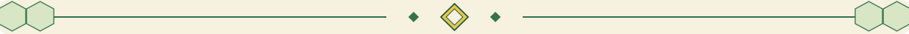

  

  <strong>Curious mind · Analytical approach · Builder's mindset</strong> 
  Learning by building practical projects with Python, AI, data and connected systems.

  
  
  
  

  

## ◈ About me

Hi! I'm **Kunal**, an M.Tech learner focused on Computer Science and Artificial Intelligence. I enjoy taking concepts beyond notes and turning them into small, working projects. My current journey brings together **machine learning, data science, Python, IoT and web applications**.

I'm still growing as an engineer, so I value clear fundamentals, experiments, readable code and documenting what I learn just as much as the final result.

## ⬡ What I enjoy

- **Building practical projects** — turning an idea into a working prototype.
- **Exploring AI and data** — finding patterns, testing models and understanding why they work.
- **Connecting software with the real world** — sensors, ESP32, MQTT and IoT simulations.
- **Learning through experimentation** — comparing approaches instead of assuming the first solution is best.
- **Clean, thoughtful design** — interfaces and documentation that make technical work easier to understand.

  

## ◈ My toolkit

*Tools and technologies I use or am actively learning through projects.*

### Programming & data

  
  
  
  
  

### AI, machine learning & soft computing

  
  
  
  
  

### Web, tools & IoT

  
  
  
  
  
  
  
  

## ⬡ What I'm learning and working with

| Area | Topics I'm exploring |
|---|---|
| **Machine learning** | Regression, classification, model comparison, validation and feature engineering |
| **Data science** | Data cleaning, exploratory analysis, visualisation and turning results into useful insights |
| **NLP & research tools** | Text processing, document search, similarity and extractive summarisation |
| **IoT & soft computing** | ESP32, MQTT, sensor data, fuzzy logic and prediction workflows |
| **Application building** | Python apps, browser interfaces, APIs, GitHub workflows and deployment fundamentals |

  

## ◈ Selected projects

### 01 · Research Paper Intelligence Assistant
A tool for extracting information from PDF research papers, searching for relevant passages, creating extractive summaries and exploring document-level insights.

**Focus:** Python · NLP · Information retrieval · Data analysis

### 02 · Student Performance Prediction
A machine-learning project comparing regression models to estimate final student grades from selected academic and attendance features.

**Focus:** Pandas · scikit-learn · Regression · Model evaluation

### 03 · Adaptive AI Tutor
An adaptive learning prototype that uses question difficulty, response similarity and mastery updates to shape a learner's practice session.

**Focus:** Python · Embeddings · Adaptive learning · Learning analytics

### 04 · SmartRain AI
An IoT/ML concept combining ESP32 telemetry, MQTT, rain prediction and fuzzy-logic ideas into a connected workflow.

**Focus:** ESP32 · MQTT · Machine learning · Soft computing

### 05 · Queen Bee Cell Timing Research
A research-oriented project exploring how machine learning, IoT sensor data and soft computing might help study the timing of queen-bee cell development.

**Focus:** Applied ML · Sensor data · Research · Fuzzy logic

> Projects evolve as I learn. I aim to keep improving the code, testing assumptions and documenting the trade-offs behind each implementation.

## ◈ How I like to work

`Understand the problem` → `Explore the data` → `Build a baseline` → `Evaluate` → `Improve` → `Document and share`

I try to make projects **useful, explainable and reproducible** rather than adding complexity just for the sake of it.

## ◈ Find me around the web

- **GitHub:** [@OMDATTA](https://github.com/OMDATTA)
- **LinkedIn:** [Kunal Datta](https://www.linkedin.com/in/kunal-datta-19bb91313/)

  

  <em>✦ Stay curious. Build patiently. Make the useful thing. ✦</em> 
  Forest green for focus · Cream for clarity · Honey yellow for bright ideas

