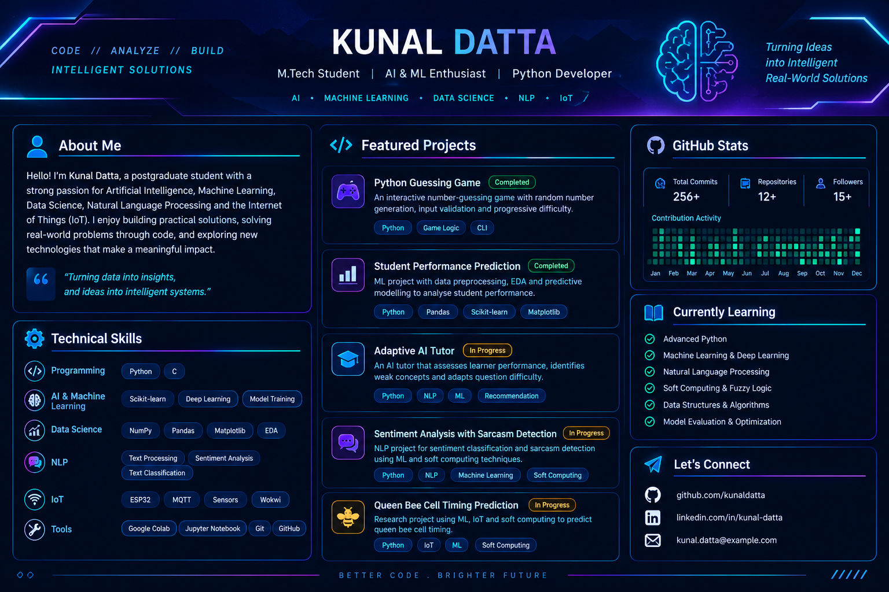

<!-- NEON PROFILE BANNER -->

  

### `AI` ⚡ `MACHINE LEARNING` ⚡ `DATA SCIENCE` ⚡ `NLP` ⚡ `IoT`

*Turning ideas into intelligent solutions.*

<!-- NEON DIVIDER -->

## 👨‍💻 About Me

I'm a postgraduate student passionate about **Artificial Intelligence, Machine Learning, Python, Data Science, and IoT**. I enjoy building practical projects that combine intelligent software, predictive modelling, and real-world problem-solving.

<!-- NEON SKILL BADGES -->

  
  
  
  
  

<!-- NEON DIVIDER -->

## 🚀 Featured Projects

| Project | Description | Status |
|---|---|---|
| 🎮 Python Guessing Game | Interactive game with validation and enhanced gameplay | Completed |
| 📊 Student Performance Prediction | Data analysis and predictive modelling | Completed |
| 🤖 Adaptive AI Tutor | Adaptive learning and question difficulty | In Progress |
| 💬 Sentiment Analysis with Sarcasm Detection | NLP-based sentiment and sarcasm classification | In Progress |
| 🐝 Queen Bee Cell Timing Prediction | ML, IoT, and soft computing research | In Progress |

<!-- NEON DIVIDER -->

## ⚙️ Tech Stack

- **Languages:** Python, C
- **Machine Learning:** Scikit-learn, predictive modelling, model evaluation
- **Data Science:** NumPy, Pandas, Matplotlib, EDA
- **NLP:** Text processing, sentiment analysis, text classification
- **IoT:** ESP32, MQTT, sensors, Wokwi
- **Tools:** Google Colab, Jupyter Notebook, Git, GitHub

## 📈 GitHub Analytics

  
  

<!-- NEON DIVIDER -->

## 🧠 Currently Learning

- Advanced Python programming
- Machine Learning and Deep Learning
- NLP and Soft Computing
- Fuzzy Logic and optimization
- Data Structures and Algorithms

## 🌐 Connect With Me

  
  

**`BUILD • LEARN • INNOVATE`**

---

⭐ Thanks for visiting my profile! Feel free to explore my repositories, share suggestions, and connect with me to discuss technology and collaborative projects.
